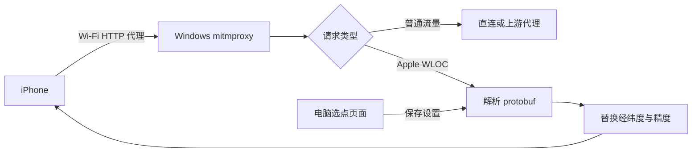

# WLOC Windows Proxy


在 Windows 上运行的 Apple WLOC 网络定位改写代理。电脑端地图选点，iPhone 只需配置 Wi‑Fi HTTP 代理，无需在手机运行 Surge、Shadowrocket 或 VPN。

> Windows-hosted Apple WLOC response rewriting proxy for authorized iOS testing.

## 功能

- 拦截 `gs-loc.apple.com/clls/wloc` 与 `gs-loc-cn.apple.com/clls/wloc`
- 保留原始二进制结构，改写 Wi‑Fi/基站定位中的经纬度和精度
- 支持 mitmproxy 自动处理的 gzip、HTTP/1.1 与 HTTP/2 响应
- Windows 本地地图选点、手动输入坐标、启用和停止模拟
- 设置持久化，代理重启后继续生效
- 可选串联 Clash Verge、Mihomo 等现有 HTTP 上游代理
- 计划任务开机启动；防火墙仅允许专用网络的本地子网访问
- 未设置坐标或停止模拟时原样放行 WLOC 响应

## 原理



本项目修改的是 Apple Wi‑Fi/基站网络定位响应，不是 GPS/GNSS 硬件读数，也不是 iOS 权限绕过。

## 使用前提

- Windows 10/11 64 位
- Python 3.12 或更高版本，建议从 [python.org](https://www.python.org/downloads/windows/) 安装
- Windows 管理员权限
- iPhone 与 Windows 位于同一个受信任的局域网
- 自己拥有或已获得明确授权的测试设备

## 快速安装

下载或克隆本仓库，在仓库目录中以管理员身份打开 PowerShell：

```powershell
Set-ExecutionPolicy -Scope Process Bypass -Force
.\install.ps1
```

默认配置：

| 参数 | 默认值 | 说明 |
|---|---:|---|
| `ListenHost` | `0.0.0.0` | 代理监听地址 |
| `ProxyPort` | `8080` | iPhone 填写的 Wi‑Fi 代理端口 |
| `SettingsPort` | `8081` | 仅 Windows 本机可访问的选点页面端口 |
| `UpstreamProxy` | 空 | 可选 HTTP/HTTPS 上游代理 |

指定电脑局域网 IP：

```powershell
.\install.ps1 -ListenHost 192.168.1.100
```

串联本机 Clash Verge/Mihomo 的 `7897` 端口：

```powershell
.\install.ps1 -UpstreamProxy http://127.0.0.1:7897
```

组合使用：

```powershell
.\install.ps1 `
  -ListenHost 192.168.1.100 `
  -ProxyPort 8080 `
  -SettingsPort 8081 `
  -UpstreamProxy http://127.0.0.1:7897
```

安装程序会：

1. 创建 `C:\ProgramData\WlocProxy`；
2. 建立独立 Python 虚拟环境并安装锁定版本的 mitmproxy；
3. 注册 SYSTEM 计划任务 `WLOC Proxy`；
4. 添加仅限专用网络、本地子网的 Windows 防火墙规则；
5. 在公共桌面创建 `WLOC Location Settings` 快捷方式；
6. 启动代理并检查设置服务健康状态。

## iPhone 配置

### 1. 配置 Wi‑Fi HTTP 代理

进入：

```text
设置 → Wi‑Fi → 当前网络右侧的 ⓘ → 配置代理 → 手动
```

填写：

```text
服务器：Windows 的局域网 IPv4 地址
端口：8080（或安装时指定的 ProxyPort）
鉴定：关闭
```

不要直接填写 Clash/Mihomo 的上游端口；否则会绕过 WLOC 改写层。

### 2. 安装 mitmproxy CA

保持 Wi‑Fi 代理开启，在 iPhone Safari 打开：

```text
http://mitm.it
```

下载 Apple/iOS 证书，然后完成两步：

1. `设置 → 通用 → VPN 与设备管理`：安装描述文件；
2. `设置 → 通用 → 关于本机 → 证书信任设置`：开启完全信任。

出现“VPN 与设备管理”只是 iOS 菜单名称，手机不需要建立 VPN 连接。

### 3. 在 Windows 设置位置

双击公共桌面的 `WLOC Location Settings`，或在 Windows 浏览器打开：

```text
http://127.0.0.1:8081/
```

点击地图或输入 WGS‑84 经纬度，然后点击“保存并启用”。点击“停止模拟”会恢复透传模式。

## 验证

### 服务状态

```powershell
Get-ScheduledTask -TaskName 'WLOC Proxy'
Get-NetTCPConnection -State Listen | Where-Object LocalPort -In 8080,8081
Invoke-RestMethod http://127.0.0.1:8081/health
```

### 代理和证书

手机配置代理后：

- `http://mitm.it` 应能打开；
- 普通 HTTPS 网站应能正常访问；
- 证书必须已安装并完全信任。

### WLOC 改写

触发 iPhone 定位后查看：

```text
C:\ProgramData\WlocProxy\wloc-proxy.log
```

成功日志类似：

```text
[wloc] patched mode=frame@0 locations=2 wifi=1 cell=1 skipped=0
```

响应同时会带有调试头：

```text
X-WLOC-Proxy
X-WLOC-Patched-Locations
X-WLOC-Target
```

核心 protobuf 改写自检：

```powershell
C:\ProgramData\WlocProxy\venv\Scripts\python.exe `
  C:\ProgramData\WlocProxy\wloc_proxy.py
```

## 配置文件

安装后的机器专用配置保存在：

```text
C:\ProgramData\WlocProxy\config.json
```

格式参见 [`config.example.json`](config.example.json)：

```json
{
  "listenHost": "0.0.0.0",
  "proxyPort": 8080,
  "settingsPort": 8081,
  "upstreamProxy": ""
}
```

`settings.json` 保存当前目标坐标。两个文件均被 `.gitignore` 排除，避免提交机器专用信息。

修改安装参数时，推荐重新运行 `install.ps1`，不要直接修改正在运行的任务。

## 更新

拉取新版本后，以管理员身份重新运行原安装命令。安装程序会停止旧任务、更新脚本和依赖、保留坐标与 CA 数据，然后重新启动。

## 卸载

在仓库目录或安装目录中，以管理员身份运行：

```powershell
.\uninstall.ps1
```

卸载后还需在 iPhone 手动完成：

1. 关闭 Wi‑Fi HTTP 代理；
2. 删除 mitmproxy CA 描述文件；
3. 删除证书信任设置。

## 限制

- 只修改 Apple 网络定位，不修改 GPS/GNSS 硬件结果；强 GPS 环境可能仍显示真实位置。
- 某些 App 会结合 GPS、蓝牙、运动传感器、出口 IP 或服务端风控判断位置。
- iOS 26 及更高版本可能长期缓存 `locationd` 结果；切换坐标后可能需要重启 iPhone。
- 代理只在当前局域网、Windows 在线且后台任务正常运行时可用。
- 配置上游代理后，上游不可用时不会自动直连，避免意外绕过既定代理策略。

## 安全说明

HTTPS 中间人证书具有较高权限：

- 只在自己拥有或明确授权的设备上安装；
- 只在受信任的专用局域网使用；
- 不要把代理端口暴露到公网；
- 测试结束后关闭手机代理并删除 CA；
- 不要用本项目欺骗服务、绕过规则或伪造生产环境定位数据。

本项目仅用于授权测试、安全研究和 QA 定位场景复现，不是 Apple CVE，也不提供任何隐蔽安装或权限绕过能力。

## 文件

| 文件 | 用途 |
|---|---|
| `wloc_proxy.py` | mitmproxy 插件、protobuf 改写与本地选点页面 |
| `run.ps1` | 计划任务实际运行入口 |
| `install.ps1` | 管理员一键安装/更新 |
| `uninstall.ps1` | 完整卸载 |
| `requirements.txt` | Python 依赖锁定 |
| `config.example.json` | 机器配置示例 |

## 致谢与许可证

- WLOC 网络定位测试思路参考 [Yu9191/wloc](https://github.com/Yu9191/wloc)。
- protobuf WLOC 响应遍历与改写设计基于 MIT 许可项目 [FFF686868/proxypin-wloc-spoofer](https://github.com/FFF686868/proxypin-wloc-spoofer)。
- HTTPS 代理由 [mitmproxy](https://mitmproxy.org/) 提供。
- 地图界面使用 [Leaflet](https://leafletjs.com/) 和 [OpenStreetMap](https://www.openstreetmap.org/) 在线资源。

本项目使用 MIT License，第三方归属见 [`THIRD_PARTY_NOTICES.txt`](THIRD_PARTY_NOTICES.txt)。
